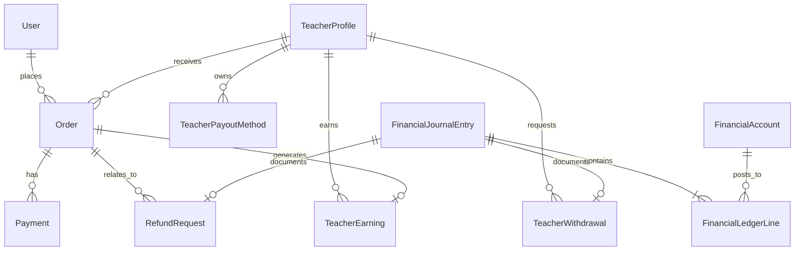

# وثيقة التحقق المعماري المالي وخطة الترحيل لقاعدة البيانات
# Financial Schema Validation & Migration Plan
**Siraj Academy — Financial Systems Engineering**
**التاريخ:** 21 نوفمبر 2026  
**الحالة:** معتمد للمراجعة الهندسية (Validation Complete — Pending Final Migration Approval)

---

## 1. فحص وتدقيق البيانات الحالية (Current Database Audit)

### 1.1 نتيجة الفحص الميداني لقاعدة البيانات (Live DB Inspection)
تم إجراء فحص فعلي لقاعدة البيانات الحالية وأخذ نسخة احتياطية كاملة (Full Logical Backup) محفوظة في المسار:
`apps/server/backups/db-backup-2026-11-21T12-06-13-744Z.json`

**إحصائيات الجداول الحالية:**
* `user`: 14 سجل (مستخدمون نشطون: طلاب، مدرسون، إدارة).
* `teacherProfile`: 7 سجلات.
* `courseOffering`: 12 دورة تدريبية.
* `lesson`: 72 درسًا.
* `order`: 0 سجلات (لا توجد طلبات سابقة في بيئة العمل الحالية).
* `payment`: 0 سجلات (لا توجد مدفوعات مسجلة سابقًا).
* `enrollment`: 0 سجلات.
* `service`: 0 سجلات.
* `setting`: 18 مفتاح إعدادات (من بينها `commission_rate`, `bank_name`, `iban`).

### 1.2 ضمانات عدم فقدان البيانات (Zero Data Loss Guarantees)
1. **منع الـ Reset أو Push الإجباري:** لن يتم استخدام `prisma migrate reset` أو `prisma db push --force-reset` قطعيًا.
2. **عزل التعديلات:** لا يتم حذف أو تعديل أي عمود في جداول `User`, `TeacherProfile`, `Order`, `Payment`, `CourseOffering`.
3. **سلامة الجداول القائمة:** تظل العلاقات الأجنبية (Foreign Keys) لجداول `Order` و`Payment` قائمة بنسبة 100% دون المساس بهيكليتها.

---

## 2. التصميم النهائي للجداول والعلاقات (Final Schema Design)

### 2.1 مخطط الكيانات والعلاقات (ER Diagram)



### 2.2 الحسابات المالية المعتمدة (Chart of Accounts - Double Entry)

| كود الحساب | اسم الحساب (بالعربية) | اسم الحساب (بالإنجليزية) | النوع (Type) | طبيعة الحساب |
| :--- | :--- | :--- | :--- | :--- |
| **1010** | حساب البنك التشغيلي للمنصة | Platform Operating Bank Account | `ASSET` | مدين (Debit) |
| **1020** | ذمم الطلاب المدينة | Student Receivables | `ASSET` | مدين (Debit) |
| **2010** | ودائع وأمانات الطلاب | Student Funds Liability | `LIABILITY` | دائن (Credit) |
| **2020** | مستحقات المدرسين المتاحة للسحب | Teacher Payable - Available | `LIABILITY` | دائن (Credit) |
| **2021** | مستحقات المدرسين المحجوزة قيد السحب | Teacher Payable - Reserved | `LIABILITY` | دائن (Credit) |
| **2030** | مستحقات الاسترداد قيد التحويل | Refund Clearing Payable | `LIABILITY` | دائن (Credit) |
| **4010** | إيرادات عمولات المنصة | Platform Commission Revenue | `REVENUE` | دائن (Credit) |
| **5010** | رسوم الحوالات والبنك | Bank Transfer Fees Expense | `EXPENSE` | مدين (Debit) |
| **5020** | تسويات وفروقات مالية | Financial Adjustments | `EXPENSE` | مدين (Debit) |

---

## 3. تصميم القيود المالية المزدوجة (Double-Entry Posting Rules)

تلتزم جميع العمليات بقاعدة القيد المزدوج الإلزامية:
$$\sum \text{Debit} = \sum \text{Credit}$$

### 3.1 دورة حياة العمليات والقيود المالية

#### أ. اعتماد دفعة طالب (Student Payment Approval)
* المبلغ الإجمالي: $1000$ ريال
```
من حـ/ 1010 حساب البنك التشغيلي (Asset +)       1000 ريال (مدين Debit)
   إلى حـ/ 2010 ودائع وأمانات الطلاب (Liability +)    1000 ريال (دائن Credit)
```

#### ب. استحقاق أرباح المدرس واقتطاع العمولة (Earning Realization)
* عند اكتمال الخدمة أو انتهاء نافذة الضمان (مثلاً عمولة المنصة 15% = 150 ريال، والمدرس 850 ريال):
```
من حـ/ 2010 ودائع وأمانات الطلاب (Liability -)      1000 ريال (مدين Debit)
   إلى حـ/ 4010 إيرادات عمولات المنصة (Revenue +)       150 ريال (دائن Credit)
   إلى حـ/ 2020 مستحقات المدرسين المتاحة (Liability +)  850 ريال (دائن Credit)
```

#### جـ. حجز رصيد سحب المدرس (Teacher Withdrawal Reservation)
* عند قيام المدرس بطلب سحب مبلغ 850 ريال (عملية ذرية لحماية الرصيد):
```
من حـ/ 2020 مستحقات المدرسين المتاحة (Liability -)   850 ريال (مدين Debit)
   إلى حـ/ 2021 مستحقات المدرسين المحجوزة (Liability +) 850 ريال (دائن Credit)
```

#### د. تنفيذ الحوالة البنكية للمدرس (Teacher Payout Executed)
* بعد قيام الإدارة بالتحويل البنكي ورفع السند ورقم الحوالة:
```
من حـ/ 2021 مستحقات المدرسين المحجوزة (Liability -) 850 ريال (مدين Debit)
   إلى حـ/ 1010 حساب البنك التشغيلي (Asset -)        850 ريال (دائن Credit)
```

#### هـ. رفض أو فشل طلب السحب (Withdrawal Rejected/Failed)
* فك حجز الرصيد وإعادته لحساب المدرس المتاح فوراً:
```
من حـ/ 2021 مستحقات المدرسين المحجوزة (Liability -) 850 ريال (مدين Debit)
   إلى حـ/ 2020 مستحقات المدرسين المتاحة (Liability +) 850 ريال (دائن Credit)
```

#### و. اعتماد استرداد الطالب (Student Refund Approved)
* قبل تنفيذ التحويل البنكي:
```
من حـ/ 2010 ودائع وأمانات الطلاب (Liability -)      1000 ريال (مدين Debit)
   إلى حـ/ 2030 مستحقات الاسترداد قيد التحويل (Liability +) 1000 ريال (دائن Credit)
```

#### ز. تنفيذ تحويل الاسترداد البنكي وسحب الصلاحية (Refund Executed)
* بعد التحويل البنكي الفعلي ورفع إيصال الحوالة:
```
من حـ/ 2030 مستحقات الاسترداد قيد التحويل (Liability -) 1000 ريال (مدين Debit)
   إلى حـ/ 1010 حساب البنك التشغيلي (Asset -)        1000 ريال (دائن Credit)
```
* **شرط أمان حاسم:** يتم استدعاء دالة سحب الصلاحية `revokeAccess` **فقط وحصرياً** بعد نجاح هذا القيد وتأكيد الحوالة البنكية، وليس عند مجرد الموافقة المبدئية.

---

## 4. قواعد احتساب الأرباح واللقطة اللحظية (Snapshot & Idempotency)

1. **اللقطة اللحظية (Immutable Snapshot):**
   * عند إنشاء استحقاق المدرس (`TeacherEarning`)، يتم تخزين:
     * `grossAmount`: إجمالي قيمة الطلب.
     * `commissionRate`: النسبة المئوية الدقيقة وقت العملية (مثال: `0.15`).
     * `commissionAmount`: قيمة العمولة بالريال.
     * `netAmount`: صافي استحقاق المدرس المالي.
   * لا يُعاد احتساب هذه الأرقام أبدًا في حال تغيّرت الإعدادات العامة للمنصة مستقبلاً.
2. **منع الاستحقاق المكرر (Strict Idempotency):**
   * جدول `TeacherEarning` يفرض قيد فريد قطعي `@unique([orderId])`.
   * لا يمكن إنشاء قيد استحقاق مالي لنفس الطلب أكثر من مرة واحدة في النظام.
3. **فترة إتاحة الرصيد للسحب (Clearing Period):**
   * في الدورات التدريبية: تتاح بعد انتهاء فترة الضمان المقررة (مثلاً 14 يومًا).
   * في الخدمات الخاصة: تتاح بمجرد تأكيد إنجاز الخدمة من الطالب أو موافقة الإدارة.

---

## 5. أمان الاسترداد وأمان السحب (Refund & Withdrawal Security)

| المتطلب الأمني | الحل المعماري المنفذ |
| :--- | :--- |
| **سحب الصلاحية الأكاديمية** | لا يتم سحب الصلاحية (`revokeAccess`) عند مجرد الموافقة الإدارية `APPROVED`؛ بل تؤجل حتى تنفيذ الحوالة البنكية الفعلية ورفع إشعار التحويل `REFUNDED`. |
| **فصل الموافقة عن التنفيذ** | دورة العمل مقسمة لمرحلتين: المراجعة الإدارية (`Review & Decision`) ثم الصرف المالي والتنفيذ البنكي (`Financial Execution & Receipt Upload`). |
| **سقف الاسترداد ومنع التجاوز** | فحص برمجي صارم: $\sum \text{PreviousRefunds} + \text{RequestedAmount} \le \text{OrderAmount}$. |
| **منع التكرار (Race Condition)** | منع تقديم طلب استرداد جديد إذا كان هناك طلب قيد المراجعة (`PENDING`, `UNDER_REVIEW`, `APPROVED`). |
| **حجز رصيد السحب الذري** | حجز المبلغ داخل معاملة قاعدة بيانات (`prisma.$transaction`) برمز `RESERVED`؛ ولا يُخصم نهائيًا إلا بسند الحوالة البنكية. |
| **عدم الوثوق بالواجهة الأمامية** | يتم حساب الرصيد المتاح حصريًا في السيرفر عبر قيود دفتر الأستاذ (`Ledger`)؛ أي قيمة رصيد قادمة من العميل تُتجاهل تمامًا. |

---

## 6. حماية البيانات البنكية والتشفير (Bank Data Security)

1. **خوارزمية التشفير:** تشفير معتمد من الدرجة العسكرية **AES-256-GCM**.
2. **مفتاح التشفير:** يُخزّن في متغير البيئة `FINANCE_ENCRYPTION_KEY` (32-byte Base64/Hex) ولا يتم تضمين أي مفاتيح داخل الكود المصدري أو قاعدة البيانات.
3. **تخزين الآيبان والحساب:**
   * الحقل المشفر: `ibanEncrypted` (يخزن بصيغة `iv:authTag:ciphertext`).
   * الحقل المقنع: `ibanMasked` (يخزن بصيغة العرض الآمن: `SA****************1234`).
4. **حظر السجلات (Zero Logging):**
   * يمنع منعًا باتًا طباعة الآيبان الصريح في سجلات النظام (`winston`, `console`, `error logs`).
5. **سياسة تعديل الحسابات البنكية:**
   * يُمنع المدرس برمجياً من تعديل أو حذف وسيلة السحب إذا كان لديه طلب سحب قائم بحالة `PENDING` أو `PROCESSING`.

---

## 7. معالجة البيانات التاريخية (Historical Data Strategy)

بناءً على الفحص الفعلي:
* بيئة النظام الحالية **لا تحتوي على أي دفعات أو طلبات سابقة** (`order: 0`, `payment: 0`).
* في حال تطبيق الترحيل على بيئة إنتاجية تحوي دفعات تاريخية:
  1. لا يتم تخمين أرباح تاريخية غير موثقة تلقائيًا.
  2. يتم تشغيل سكريبت فحص يحصر الدفعات السابقة؛ وإذا كانت نسبة العمولة غير مسجلة في سجل الدفعة الأصلي، تُصنف كـ `LEGACY_UNRECONCILED` وتُحال للمراجعة والاعتماد اليدوي من الإدارة المالية.
  3. لا يُضاف أي رصيد تاريخي لمحفظة المدرس المتاحة للسحب دون قيد تسوية معتمد من الإدارة المالية.

---

## 8. خطة الـ Migration وخطة الـ Rollback

### 8.1 أسلوب الترحيل المعتمد (Safe Migration Procedure)
سنستخدم آلية الترحيل الآمنة ذات الرقابة الكاملة:
```bash
npx prisma migrate dev --create-only --name add_financial_ledger_and_wallets
```
* **الفائدة:** تقوم هذه التعليمة بإنشاء ملف الـ SQL الترحيلي في مجلد `prisma/migrations` دون تطبيقه مباشرة على قاعدة البيانات، مما يتيح لنا مراجعة كود الـ SQL سطراً بسطر والتأكد من خلوه من أي تعليمات `DROP TABLE` أو `DROP COLUMN`.

### 8.2 كود الـ SQL الترحيلي المتوقع (Migration SQL Preview)
يتضمن حصرياً تعليمات الإنشاء `CREATE TABLE` و `CREATE TYPE` وإضافة حقول الربط الاختيارية:
```sql
-- 1. إنشاء الأنواع والـ Enums المالية
CREATE TYPE "FinancialAccountType" AS ENUM ('ASSET', 'LIABILITY', 'EQUITY', 'REVENUE', 'EXPENSE');
CREATE TYPE "JournalEntryType" AS ENUM ('PAYMENT_DEPOSIT', 'EARNING_REALIZATION', 'WITHDRAWAL_RESERVE', 'WITHDRAWAL_PAYOUT', 'WITHDRAWAL_RELEASE', 'REFUND_APPROVE', 'REFUND_PAYOUT', 'ADJUSTMENT');
CREATE TYPE "JournalEntryStatus" AS ENUM ('POSTED', 'REVERSED');
CREATE TYPE "DebitCredit" AS ENUM ('DEBIT', 'CREDIT');
CREATE TYPE "WithdrawalStatus" AS ENUM ('PENDING', 'UNDER_REVIEW', 'NEEDS_INFORMATION', 'APPROVED', 'PROCESSING', 'PAID', 'REJECTED', 'FAILED', 'CANCELLED');
CREATE TYPE "RefundStatus" AS ENUM ('PENDING', 'UNDER_REVIEW', 'NEEDS_INFORMATION', 'APPROVED', 'PARTIALLY_APPROVED', 'REJECTED', 'PROCESSING', 'REFUNDED', 'PARTIALLY_REFUNDED', 'FAILED', 'CANCELLED');
CREATE TYPE "EarningStatus" AS ENUM ('PENDING_CLEARING', 'AVAILABLE', 'WITHDRAWN', 'REVERSED');

-- 2. إنشاء الجداول الجديدة
CREATE TABLE "FinancialAccount" (...);
CREATE TABLE "FinancialJournalEntry" (...);
CREATE TABLE "FinancialLedgerLine" (...);
CREATE TABLE "TeacherPayoutMethod" (...);
CREATE TABLE "TeacherWithdrawal" (...);
CREATE TABLE "RefundRequest" (...);
CREATE TABLE "TeacherEarning" (...);

-- 3. بذر الحسابات المالية الافتراضية (Seed Chart of Accounts)
```

### 8.3 خطة التراجع (Rollback Plan)
في حال حدوث أي خطأ غير متوقع أثناء أو بعد الترحيل:
1. **استعادة النسخة الاحتياطية:** تتوفر نسخة JSON الكاملة لجميع الجداول في `apps/server/backups/`.
2. **سكريبت التراجع العكسي (Down Migration Script):**
   حذف الجداول والأنواع الجديدة فقط دون التأثير على أي جدول أساسي:
   ```sql
   DROP TABLE IF EXISTS "FinancialLedgerLine" CASCADE;
   DROP TABLE IF EXISTS "FinancialJournalEntry" CASCADE;
   DROP TABLE IF EXISTS "FinancialAccount" CASCADE;
   DROP TABLE IF EXISTS "TeacherEarning" CASCADE;
   DROP TABLE IF EXISTS "TeacherWithdrawal" CASCADE;
   DROP TABLE IF EXISTS "TeacherPayoutMethod" CASCADE;
   DROP TABLE IF EXISTS "RefundRequest" CASCADE;
   DROP TYPE IF EXISTS "FinancialAccountType";
   DROP TYPE IF EXISTS "JournalEntryType";
   DROP TYPE IF EXISTS "JournalEntryStatus";
   DROP TYPE IF EXISTS "DebitCredit";
   DROP TYPE IF EXISTS "WithdrawalStatus";
   DROP TYPE IF EXISTS "RefundStatus";
   DROP TYPE IF EXISTS "EarningStatus";
   ```

---

## 9. قائمة الملفات التي سيتم إنشاؤها وتعديلها في المراحل التالية

1. **قاعدة البيانات ومخطط Prisma:**
   * `apps/server/prisma/schema.prisma` (إضافة الجداول والأنواع المالية).
   * `apps/server/prisma/migrations/xxxx_add_financial_ledger_and_wallets/migration.sql`.
2. **الخدمات البرمجية الخلفية (Core Backend Services):**
   * `apps/server/src/lib/crypto.ts` (تشفير وفك تشفير الآيبان AES-256-GCM).
   * `apps/server/src/lib/ledgerService.ts` (إدارة الحسابات، قيود اليومية المزدوجة، وفحص توازن Debit = Credit).
   * `apps/server/src/lib/refundService.ts` (محرك التحقق من أهلية الاسترداد، وحالات الاسترداد).
   * `apps/server/src/lib/teacherWalletService.ts` (حساب الأرصدة، حجز مبالغ السحب، وإدارة الحسابات البنكية).
3. **المسارات البرمجية (API Routes & Security):**
   * `apps/server/src/routes/refunds.ts` (مسارات الطلاب والإدارة للاسترداد).
   * `apps/server/src/routes/withdrawals.ts` (مسارات المدرسين والإدارة للسحب).
   * `apps/server/src/routes/payments.ts` (ربط اعتماد الدفع بتسجيل قيود دفتر الأستاذ الفورية).
4. **الواجهة الأمامية (Frontend Pages & State):**
   * `apps/web/src/pages/dashboard/student/StudentRefunds.tsx` (قسم استرداد الأموال للطلاب).
   * `apps/web/src/pages/dashboard/teacher/TeacherEarnings.tsx` (ترقية محفظة وأرباح المدرس).
   * `apps/web/src/pages/dashboard/admin/AdminRefunds.tsx` و `AdminWithdrawals.tsx` (إدارة الحوالات والاعتماد).
5. **الاختبارات والتوثيق (Testing & Documentation):**
   * `apps/server/tests/financial-system-suite.ts` (حزمة الاختبارات الآلية الـ 15).
   * ملفات التوثيق الرسمية في مجلد `docs/`.

---

**جاهز للمراجعة. بانتظار موافقتك الصريحة لتنفيذ المرحلة الثانية ومباشرة الـ Migration.**
