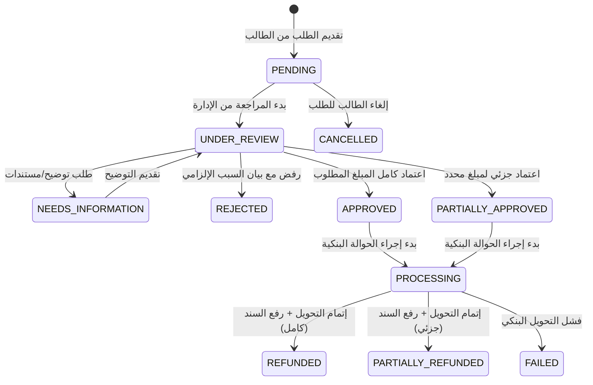

# نظام استرداد أموال الطلاب — التوثيق الهندسي والتشغيلي
# Student Refund System Architecture & Specification
**منصة أكاديمية سراج التعليمية (Siraj Academy)**  
**الإصدار:** 1.0.0 (Production-Ready)  
**التاريخ:** 21 نوفمبر 2026

---

## 1. نظرة عامة (Overview)

نظام استرداد أموال الطلاب هو نظام مالي مستقل ومحكم يتيح للطلاب تقديم طلبات استرداد للرسوم المدفوعة عن الدورات والخدمات الأكاديمية وفق سياسة الاسترداد المعتمدة للمنصة، مع دورة عمل إدارية تفصل بين المراجعة والاعتماد وبين التنفيذ والصرف البنكي الفعلي.

---

## 2. محرك التحقق من أهلية الاسترداد (Refund Eligibility Engine)

يتحقق المحرك آلياً من الشروط التالية قبل السماح للطالب بتقديم طلب الاسترداد:
1. **ملكية الطلب:** يجب أن يكون الطلب تابعاً للمستخدم المسجل الحالي (`order.studentId === user.id`).
2. **حالة السداد:** يجب أن يكون الطلب في حالة مدفوع (`status === 'PAID'`) ومثبت بسند دفع معتمد (`Payment.status === 'APPROVED'`).
3. **منع التكرار والتزامن:** يُمنع تقديم طلب استرداد جديد إذا كان هناك طلب نشط حالياً بحالة:
   * `PENDING`
   * `UNDER_REVIEW`
   * `NEEDS_INFORMATION`
   * `APPROVED`
   * `PARTIALLY_APPROVED`
   * `PROCESSING`
4. **سقف الاسترداد:** يُحسب الحد الأقصى للمبلغ القابل للاسترداد ديناميكياً:
   $$\text{MaxRefundable} = \text{OrderAmount} - \sum \text{PreviouslyApprovedRefunds}$$
   إذا كان المتبقي $\le 0$ ريال، يُصنف الطلب بأنه مسترد بالكامل وغير مؤهل.

---

## 3. آلة الحالات (State Machine)

---

## 4. القيود المحاسبية المزدوجة للاسترداد (Double-Entry Postings)

### أ. عند اعتماد الاسترداد (Approval):
يتم حجز مبلغ الاسترداد المعتمد محاسبياً بنقله من ودائع الطلاب إلى أمانات الاسترداد:
* **مدين (Debit):** `2010 ودائع وأمانات الطلاب` (Student Funds Liability)
* **دائن (Credit):** `2030 مستحقات الاسترداد قيد التحويل` (Refund Clearing Payable)

### ب. عند تنفيذ الحوالة البنكية الفعلية (Payout Execution):
يتم إقفال التزام الاسترداد وخصم المبلغ من الحساب البنكي التشغيلي للمنصة:
* **مدين (Debit):** `2030 مستحقات الاسترداد قيد التحويل` (Refund Clearing Payable)
* **دائن (Credit):** `1010 حساب البنك التشغيلي للمنصة` (Platform Operating Bank Account)

> [!IMPORTANT]
> **قاعدة أمان الصلاحيات:** لا يتم سحب صلاحية الطالب الأكاديمية (مثل إلغاء التسجيل `Enrollment`) عند الاعتماد المبدئي، بل **فقط وحصرياً** عند اكتمال القيد الثاني وتأكيد التحويل البنكي الفعلي برقم الحوالة وسند البنك.

---

## 5. واجهات برمجة التطبيقات (API Reference)

| المسار | الطريقة | الصلاحية | الوصف |
| :--- | :---: | :---: | :--- |
| `/api/v1/refunds/eligible` | `GET` | `STUDENT` | قائمة الطلبات المؤهلة للاسترداد وسقوفها المالية |
| `/api/v1/refunds/check/:orderId` | `GET` | `STUDENT` | فحص أهلية طلب محدد |
| `/api/v1/refunds` | `POST` | `STUDENT` | تقديم طلب استرداد جديد |
| `/api/v1/refunds/mine` | `GET` | `STUDENT` | سجل وتاريخ طلبات الاسترداد للطالب |
| `/api/v1/refunds/:id/cancel` | `PATCH` | `STUDENT` | إلغاء طلب استرداد معلق |
| `/api/v1/refunds/admin/all` | `GET` | `ADMIN` | استعراض كافة طلبات الاسترداد مع الفلاتر |
| `/api/v1/refunds/admin/:id/review` | `PATCH` | `ADMIN` | مراجعة الطلب (اعتماد كلي/جزئي أو رفض ببيان السبب) |
| `/api/v1/refunds/admin/:id/execute` | `POST` | `ADMIN` | توثيق التحويل البنكي ورفع السند وسحب الصلاحية |
