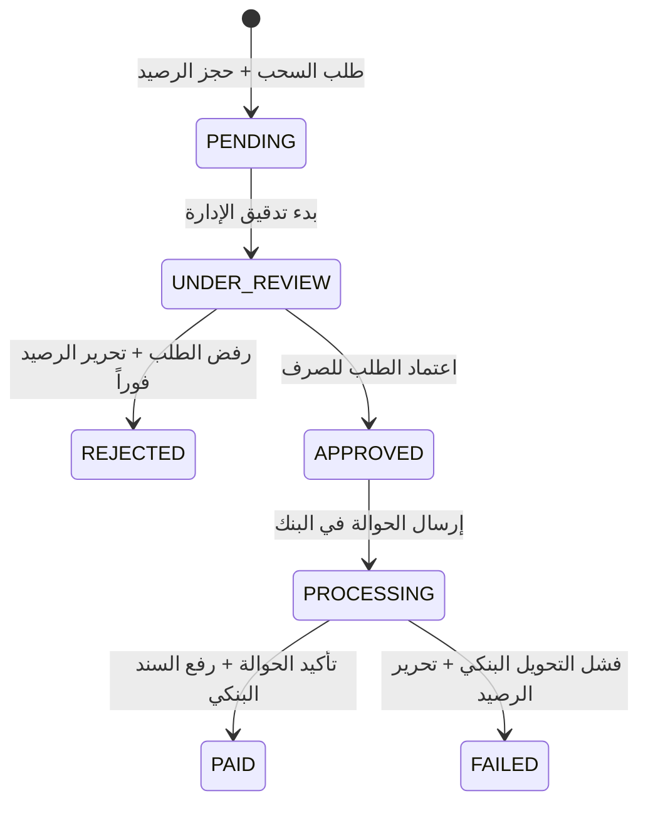

# نظام سحب أرباح المدرسين والمحفظة المالية
# Teacher Earnings & Withdrawal System Architecture
**منصة أكاديمية سراج التعليمية (Siraj Academy)**  
**الإصدار:** 1.0.0 (Production-Ready)  
**التاريخ:** 21 نوفمبر 2026

---

## 1. نظرة عامة (Overview)

نظام متكامل ومستقل لإدارة المحفظة المالية للمدرسين؛ يتيح استعراض كشف الحساب، وتتبع استحقاقات المبيعات مع تثبيت لقطة عمولة المنصة لحظياً، وحفظ الحسابات البنكية المشفرة، وطلب سحب الأرباح مع حجز الرصيد الذري لمنع السحب المزدوج.

---

## 2. احتساب الأرصدة وقواعد المحفظة (Wallet Balance Engine)

يتم احتساب أرصدة المحفظة بالكامل على الخادم من خلال قيود الاستحقاق والسحب:
1. **إجمالي الأرباح المحققة (`earnedTotal`):**
   مجموع صافي استحقاقات المدرس من جدول `TeacherEarning` للحالات المعتمدة (`AVAILABLE` أو `WITHDRAWN`).
2. **الرصيد المحجوز (`reservedBalance`):**
   مجموع مبالغ طلبات السحب الجارية التي لم تُصرف بعد (`PENDING`, `UNDER_REVIEW`, `APPROVED`, `PROCESSING`).
3. **إجمالي المسحوبات المحولة (`withdrawnTotal`):**
   مجموع مبالغ طلبات السحب المنفذة نهائياً بحوالة بنكية مؤكدة (`PAID`).
4. **الرصيد الصافي المتاح للسحب (`availableBalance`):**
   $$\text{AvailableBalance} = \max\Big(0, \text{EarnedTotal} - \text{WithdrawnTotal} - \text{ReservedBalance}\Big)$$

---

## 3. تثبيت لقطة العمولة ومنع التكرار (Snapshot & Idempotency)

* **اللقطة اللحظية (Immutable Snapshot):** فور اعتماد الدفع لطلب الطالب، يتم احتساب حصة المدرس وعمولة المنصة وفق نسبة العمولة في الإعدادات في تلك اللحظة وتخزينها في `TeacherEarning`. لا تتغير هذه المبالغ التاريخية إذا تم تعديل نسبة عمولة المنصة لاحقاً.
* **دعم تعدد المدرسين ومنع التكرار:** يعتمد جدول `TeacherEarning` قيداً فريداً مركباً:
  ```prisma
  @@unique([orderId, teacherId])
  ```
  يضمن هذا القيد عدم تسجيل أي استحقاق مالي مكرر لنفس المدرس والطلب، مع إمكانية مشاركة أكثر من مدرس في نفس الطلب.

---

## 4. آلة الحالات لطلبات السحب (Withdrawal State Machine)



---

## 5. القيود المحاسبية المزدوجة للسحب (Double-Entry Postings)

### أ. عند طلب السحب (Reservation):
يتم حجز الرصيد فوراً لمنع السحب المزدوج:
* **مدين (Debit):** `2020 مستحقات المدرسين المتاحة للسحب` (Teacher Payable - Available)
* **دائن (Credit):** `2021 مستحقات المدرسين المحجوزة قيد السحب` (Teacher Payable - Reserved)

### ب. عند رفض الطلب (Rejection / Release):
يتم فك الحجز وإعادة المبلغ فوراً إلى الرصيد المتاح:
* **مدين (Debit):** `2021 مستحقات المدرسين المحجوزة قيد السحب` (Teacher Payable - Reserved)
* **دائن (Credit):** `2020 مستحقات المدرسين المتاحة للسحب` (Teacher Payable - Available)

### جـ. عند تنفيذ الصرف البنكي (Payout Execution):
يتم إقفال الالتزام المحجوز وخصم أموال الحوالة من بنك المنصة:
* **مدين (Debit):** `2021 مستحقات المدرسين المحجوزة قيد السحب` (Teacher Payable - Reserved)
* **دائن (Credit):** `1010 حساب البنك التشغيلي للمنصة` (Platform Operating Bank Account)

---

## 6. واجهات برمجة التطبيقات (API Reference)

| المسار | الطريقة | الصلاحية | الوصف |
| :--- | :---: | :---: | :--- |
| `/api/v1/withdrawals/teacher/wallet` | `GET` | `TEACHER` | كشف حساب المحفظة وكافة الأرصدة |
| `/api/v1/withdrawals/teacher/payout-methods` | `GET` | `TEACHER` | قائمة الحسابات البنكية المحفوظة (مقنعة) |
| `/api/v1/withdrawals/teacher/payout-methods` | `POST` | `TEACHER` | إضافة حساب بنكي معتمد وتشفير الآيبان |
| `/api/v1/withdrawals/teacher/withdraw` | `POST` | `TEACHER` | تقديم طلب سحب أرباح مع حجز الرصيد الذري |
| `/api/v1/withdrawals/teacher/history` | `GET` | `TEACHER` | سجل عمليات السحب السابقة |
| `/api/v1/withdrawals/admin/all` | `GET` | `ADMIN` | قائمة جميع مسيرات السحب للمدرسين |
| `/api/v1/withdrawals/admin/:id/review` | `PATCH` | `ADMIN` | مراجعة طلب السحب (اعتماد أو رفض مع فك الحجز) |
| `/api/v1/withdrawals/admin/:id/execute` | `POST` | `ADMIN` | توثيق تنفيذ الحوالة ورفع إشعار البنك |
